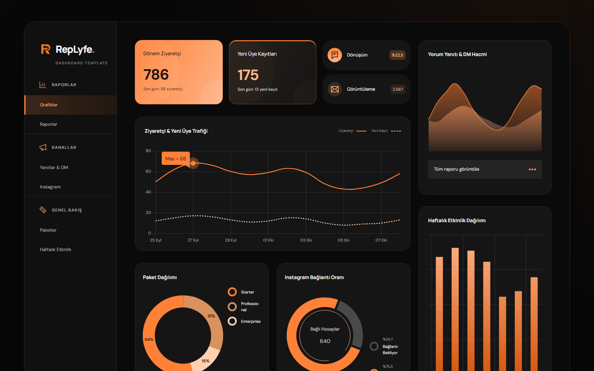
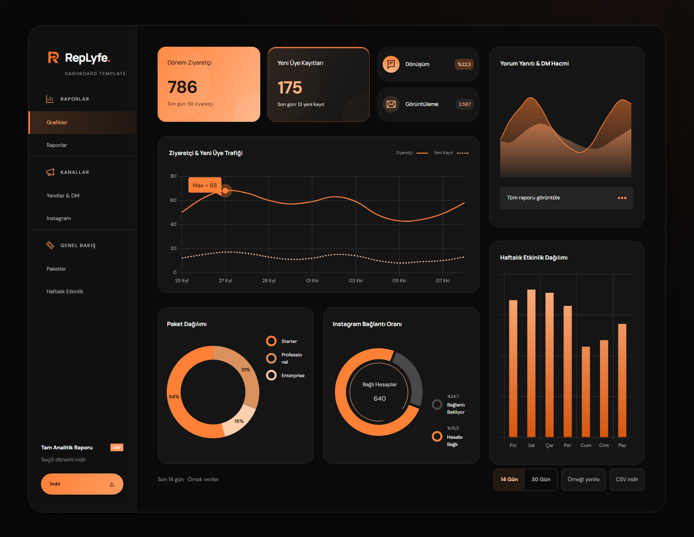
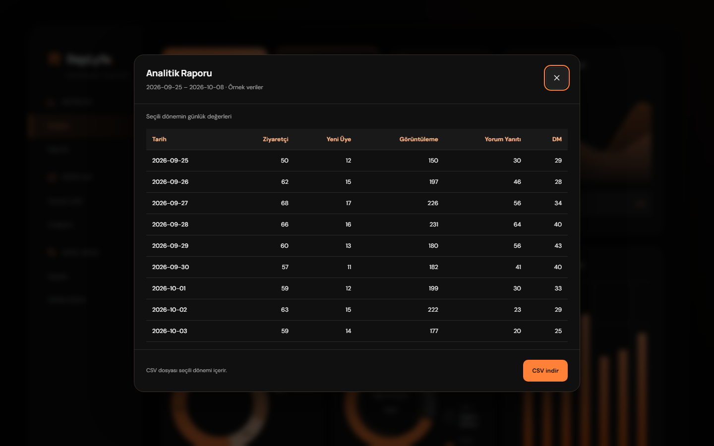
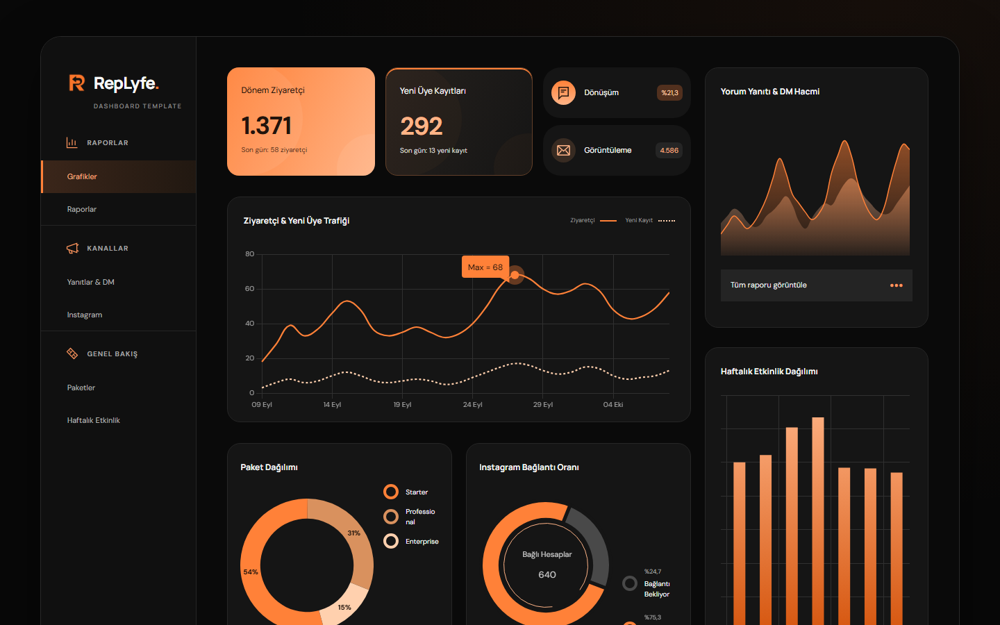
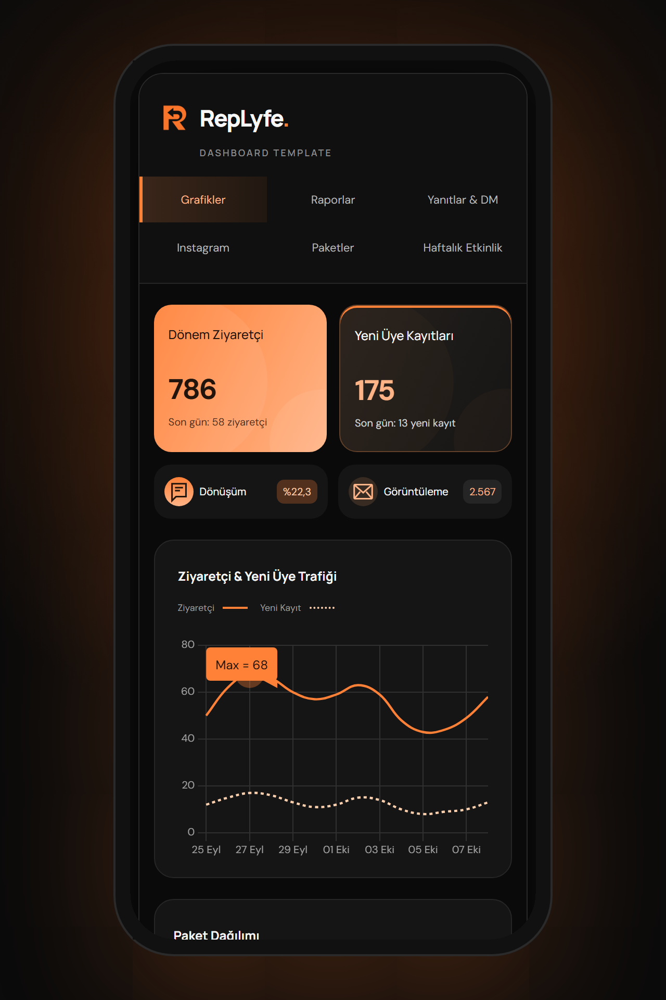

<div align="center">



# 📊 RepLyfe Dashboard

**A premium, zero-dependency SaaS analytics dashboard — in a single HTML file.**

Instagram otomasyon SaaS'ı için tasarlanmış; turuncu/siyah temalı, animasyonlu, mobil uyumlu ve tamamen çevrimdışı çalışan analitik paneli.


[Özellikler](#-özellikler) • [Ekran Görüntüleri](#-ekran-görüntüleri) • [Hızlı Başlangıç](#-hızlı-başlangıç) • [JavaScript API](#-javascript-api) • [Lisans](#-lisans)

</div>

---

## ✨ Neden bu proje?

Çoğu dashboard şablonu onlarca bağımlılık, build adımı ve sunucu ister. **RepLyfe Dashboard** ise tek bir `index.html` dosyasıdır:

> Çift tıkla → aç → çalışsın. Sunucu yok, `npm install` yok, internet yok.

Stiller, Chart.js, logo ve fontlar dosyanın içine gömülüdür. Hiçbir API isteği göndermez, hiçbir veriyi dışarı sızdırmaz.

## 🚀 Özellikler

| | Özellik | Açıklama |
|---|---|---|
| ⚡ | **Sıfır bağımlılık** | Tek dosya, build yok, kurulum yok, tamamen offline |
| 📈 | **5 interaktif grafik** | Ziyaretçi & kayıt trafiği, paket dağılımı, Instagram bağlantı oranı, yorum/DM hacmi, haftalık etkinlik |
| 🧮 | **KPI kartları** | Dönem ziyaretçi, yeni üye, dönüşüm oranı ve görüntüleme — seçili dönemden canlı hesaplanır |
| 🗓️ | **14 / 30 gün filtresi** | Tek tıkla dönem değiştirme, animasyonlu geçiş |
| 📋 | **Günlük rapor** | Modal içinde detaylı günlük analitik tablosu |
| 📥 | **CSV dışa aktarma** | Seçili dönemi Excel / Sheets uyumlu CSV olarak indirme |
| 📱 | **Tam responsive** | Masaüstü, tablet ve mobil için optimize yerleşim |
| ♿ | **Erişilebilirlik** | ARIA etiketleri, klavye navigasyonu, `prefers-reduced-motion` desteği |
| 🔌 | **JavaScript API** | `DashboardTemplate.setData()` ile kendi backend verinizi bağlayın |
| 🛡️ | **Veri doğrulama** | Geçersiz veri `TypeError` üretir, önceki geçerli veri korunur |
| 🇹🇷 | **Türkçe arayüz** | Türkçe karakter destekli gömülü DM Sans & Manrope fontları |

## 📸 Ekran Görüntüleri

<table>
  <tr>
    <td colspan="2"></td>
  </tr>
  <tr>
    <td></td>
    <td></td>
  </tr>
  <tr>
    <td></td>
    <td align="center"></td>
  </tr>
</table>

## ⚡ Hızlı Başlangıç

```bash
git clone https://github.com/Bewrq/standalone-dashboard.git
cd standalone-dashboard
# index.html dosyasına çift tıklayın — hepsi bu.
```

## 🧩 Mimari

Tüm uygulama tek bir HTML dosyasında, `id` ile ayrılmış bölümlerden oluşur:

| Bölüm | Görev |
|---|---|
| `dashboard-theme` | CSS, renk sistemi ve responsive yerleşim |
| `dashboard-data` | Örnek günlük veriler, paket ve Instagram dağılımları (JSON) |
| `dashboard-app` | Veri doğrulama, hesaplamalar ve grafik çizimi |
| `chart-engine` | Gömülü Chart.js 4.5.0 |

## 🔌 JavaScript API

```js
const veri = {
  date_keys:       ['2026-10-06', '2026-10-07', '2026-10-08'],
  daily_visitors:  [42, 58, 68],
  daily_signups:   [6, 8, 12],
  daily_pageviews: [126, 190, 220],
  daily_comments:  [20, 31, 40],
  daily_dms:       [14, 22, 27],
  plans:     { starter: 44, professional: 25, enterprise: 12 },
  instagram: { connected: 64, unconnected: 21 }
};

await DashboardTemplate.ready;
DashboardTemplate.setData(veri, 'Mağazam');
DashboardTemplate.setRange(30);    // 14 veya 30
DashboardTemplate.openReport();    // günlük tablo
DashboardTemplate.downloadCSV();   // seçili dönemi indir
```

| Metot | Açıklama |
|---|---|
| `setData(data, label)` | Veriyi doğrular ve tüm grafikleri günceller |
| `setRange(14 \| 30)` | Görünen dönemi değiştirir |
| `getData()` | Tüm verinin kopyasını döndürür |
| `getVisibleData()` | Seçili dönem + hesaplanan özet |
| `openReport()` | Günlük rapor modalını açar |
| `downloadCSV()` | Seçili dönemi CSV olarak indirir |
| `resetDemo()` | Gömülü örnek veriye döner |
| `ready` | Başlatma tamamlandığında çözülen Promise |

**Veri kuralları:** Günlük dizilerin uzunluğu `date_keys` ile aynı olmalı; tarihler eskiden yeniye, benzersiz ve `YYYY-MM-DD` formatında; sayılar sıfır veya pozitif tam sayı. 1–366 günlük veri kabul edilir.

> [!IMPORTANT]
> HTML içine API anahtarı veya sunucu sırrı koymayın. Veriyi kendi uygulamanızda alıp `setData` ile aktarın.

## 👨‍💻 Geliştirici

<table>
  <tr>
    <td align="center">
      <a href="https://github.com/Bewrq">
        <br />
        <b>Berk</b>
      </a><br />
      <a href="https://github.com/Bewrq">@Bewrq</a>
    </td>
  </tr>
</table>

## 📄 Lisans

**© 2026 [Berk](https://github.com/Bewrq) — Tüm hakları saklıdır.**

Bu proje yalnızca **portföy ve tanıtım** amacıyla herkese açık paylaşılmıştır. Açık kaynak lisansı **değildir**.

- ✅ Kodu incelemek ve kişisel olarak denemek serbesttir.
- ❌ Satmak, yeniden satmak veya şablon mağazalarında yayınlamak yasaktır.
- ❌ Kopyalayıp dağıtmak, ticari üründe / SaaS'ta / müşteri projesinde kullanmak yasaktır.
- ❌ Değiştirip türev çalışma üretmek, kendi eseriymiş gibi sunmak yasaktır.

Ticari lisans veya white-label kullanım için [GitHub profilim](https://github.com/Bewrq) üzerinden iletişime geçebilirsiniz. Detaylar için [LICENSE](LICENSE) dosyasına bakın.

Üçüncü taraf bileşenler kendi lisanslarına tabidir: Chart.js (MIT), DM Sans & Manrope (SIL OFL 1.1). Lisans metinleri `index.html` içinde gömülü olarak korunmaktadır.

---

<div align="center">

⭐ Beğendiyseniz yıldız bırakmayı unutmayın!

</div>
